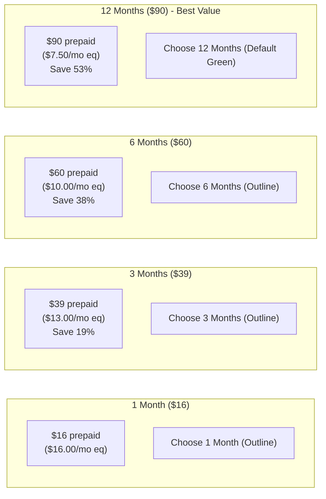
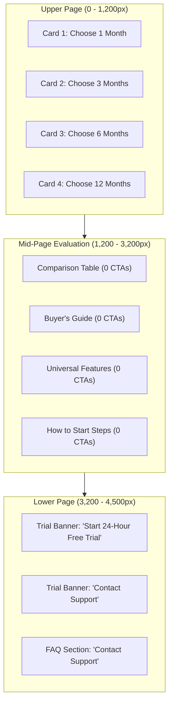

# TryIPTV Pricing UX & Conversion Audit

**Target URL:** `/pricing`  
**Target Source:** `src/app/pricing/page.tsx`  
**Supporting Components:** `src/components/sections/Pricing.tsx`, `src/lib/site-data/pricing.ts`, `src/lib/site-data/pricing-page-faq.ts`  
**Audit Phase:** Phase 7.2  
**Date:** October 11, 2026  
**Auditor:** Antigravity SEO & Commercial Architecture Team  
**Audit Scope:** Viewport responsiveness (375px, 768px, 1024px, 1440px), above-the-fold clarity, pricing card visual hierarchy, plan differentiation, comparison table utility, CTA architecture, free trial banner relationship, visual density, buyer's guide effectiveness, post-checkout expectations, and objection-handling FAQ.  
**Mode:** **STRICT AUDIT ONLY — Zero code or content modifications.**

---

## 1. Executive Summary & Overall Verdict

Following the factual truth cleanup in Phase 7.1 (which removed unhedged 4K/catalog claims, unverified credential guarantees, and the redundant Section 6 cost block), `/pricing` has achieved high factual integrity and mathematical precision.

This audit evaluates the **user experience, cognitive load, visual density, and conversion momentum** across mobile, tablet, laptop, and desktop viewports.

### Key Audit Findings:
1. **Above-the-Fold (ATF) Displacement:** On mobile (375px) and standard laptop viewports (1024px), the pricing cards and checkout CTA buttons are pushed below the fold by introductory hero elements (breadcrumb, H1, description, 5 pill badges, and the Answer-First summary box).
2. **Feature List Repetition Fatigue:** Across the 4 plan cards, the exact same 6 feature bullets are repeated 4 times (24 identical bullet points). On mobile, where cards stack vertically, users must scroll through ~1,500px of repetitive checkmark lists.
3. **Plan Differentiation Clarity:** The page succeeds in communicating that **duration and price savings are the only differences between plans**. All plans offer identical 2-connection access, full catalog availability, EPG, and player format compatibility.
4. **Comparison Table Utility:** The side-by-side table provides clean analytical comparison ($16, $39, $60, $90 upfront vs. $16.00, $13.00, $10.00, $7.50/mo eq). However, two of its five columns (*"Connections"* and *"Billing"*) have identical values (`2` and `Prepaid`) across all 4 rows.
5. **CTA Architecture & Funnel Momentum:** There is a 4-section span (~1,600px desktop, ~2,800px mobile) between the pricing cards and the bottom trial banner without a purchase CTA. However, adding buttons to the comparison table would clutter mobile layout; a cleaner approach is maintaining clear visual pathways back to plan selection.
6. **Free Trial Placement:** The Section 7 trial banner (*"Want to Test TryIPTV Before Choosing a Plan?"*) serves as an appropriate de-escalation ramp for hesitant visitors, but its high visual prominence at the bottom of the page means it is the only large button below the fold.

### Overall Verdict:
**B. Minor compression / CTA refinement**

*Rationale:* The macro-architecture (Hero $\rightarrow$ Cards $\rightarrow$ Table $\rightarrow$ Guide $\rightarrow$ Inclusions $\rightarrow$ Steps $\rightarrow$ Trial $\rightarrow$ FAQ) is commercially logical and answers real buyer objections. A radical restructuring (Option C) is uncalled for. However, leaving it unchanged (Option A) perpetuates mobile vertical scroll fatigue and introductory fold displacement. Targeted visual compression—tightening hero padding, streamlining repetitive card feature bullets, and preserving high-contrast pricing hierarchy—will maximize conversion velocity without sacrificing substantive evidence.

---

## 2. Viewport Responsiveness & Layout Analysis

| Viewport | Device Class | Layout Behavior | Visual Friction Points |
| :--- | :--- | :--- | :--- |
| **375px** | Mobile (iPhone SE / 13 mini) | Single-column stack throughout. | • **Complete ATF CTA Displacement:** Pricing cards and buttons sit entirely below the fold (~700px down). • **Card Stacking Fatigue:** 4 cards $\times$ 6 repeated bullets = ~1,500px of scrolling for Section 2 alone. • **Table Horizontal Scroll:** The 5-column table requires sideways swiping on narrow screens. |
| **768px** | Tablet (iPad Portrait) | 2-column grid for pricing cards; stacked table and guide. | • Cards render as a 2x2 grid, which is visually balanced. • The 12-Month plan sits in row 2 on the right, maintaining good visibility. |
| **1024px** | Laptop (MacBook Air / 13" Display) | 4-column horizontal pricing grid; 3-column Buyer's Guide. | • Pricing cards fit in a single row, but only their top headers are visible above the fold on initial load. • Clean card alignment and balanced whitespace. |
| **1440px** | Desktop (External Monitor / iMac) | Full horizontal grid layouts with generous margins. | • Excellent readability and scannability. • 4 cards align symmetrically with the 12-Month plan prominently highlighted. |

---

## 3. Above-the-Fold (ATF) Clarity Verdict

* **Core Information Verification within First Screen:**
  * *Plans start at $16:* **Visible.** Stated in subtitle and Answer-First box.
  * *Prepaid billing:* **Visible.** Highlighted in subtitle, badges, and Answer-First box.
  * *Available durations (1, 3, 6, 12 mo):* **Visible.** Enumerated in Answer-First box.
  * *Zero auto-renewal:* **Visible.** Stated in subtitle, badges, and Answer-First box.
  * *2 connections:* **Visible.** Stated in subtitle and badges.
  * *Primary action to choose/buy a plan:* **NOT visible on mobile; partially obscured on laptop.**
* **Hero Vertical Height Analysis:**
  * On desktop, the hero section consumes ~580px of vertical height due to generous padding (`pt-12 pb-14 sm:pt-16 sm:pb-20`), the breadcrumb, H1, subtitle, 5 pill badges, and the Answer-First summary box.
  * On mobile (375px), this introductory stack consumes ~720px, pushing the first pricing card (`1 Month / $16`) entirely off the initial screen.
* **Verdict:** The informational clarity of the hero is exceptional (every key transactional fact is grounded within 150 words), but its **vertical footprint delays direct commercial interaction**. Compressing padding and tightening the badge cluster would allow the top edge of the pricing cards to anchor the first viewport.

---

## 4. Pricing Card Visual Hierarchy Audit

### Detailed Card Audit

| Plan | Upfront Price | Monthly Eq. | Savings Badge | CTA Label & Style | Destination | Visual Treatment |
| :--- | :---: | :---: | :---: | :--- | :--- | :--- |
| **1 Month** | **$16** | $16.00/mo | None | `"Choose 1 Month"` (Outline) | Flujipay Token 1 | Standard dark card |
| **3 Months** | **$39** | $13.00/mo | `"Save 19%"` (Green pill) | `"Choose 3 Months"` (Outline) | Flujipay Token 2 | Standard dark card |
| **6 Months** | **$60** | $10.00/mo | `"Save 38%"` (Green pill) | `"Choose 6 Months"` (Outline) | Flujipay Token 3 | Standard dark card |
| **12 Months** | **$90** | $7.50/mo | `"Save 53%"` (Green pill) | `"Choose 12 Months"` (**Solid Green**) | Flujipay Token 4 | **"Best Value" badge**, green accent border |

### Hierarchy Evaluation:
* **Upfront vs. Monthly Prominence:** **Excellent.** The upfront cost (`$16`, `$39`, `$60`, `$90`) is rendered in prominent 44px bold typography, while the monthly rate is styled as secondary subtext (`"equivalent to $X.XX/month"`).
* **"Prepaid" Clarity:** A dedicated `prepaid` badge sits directly alongside the dollar figure, preventing recurring billing misunderstandings.
* **12-Month Plan Promotion:** The 12-Month plan is highlighted via a green border, subtle glow, "Best Value" chip, and solid primary CTA button. This emphasis is mathematically justified by the 53% savings ($7.50/mo vs. $16.00/mo).
* **Feature List Repetition:** Every card currently renders 6 bullets. Item 3 (*"80,000+ Movies & Series"*) and Item 5 (*"On-demand movies & series"*) are nearly identical. Trimming these to 3–4 high-impact, non-redundant bullets per card would dramatically clean up card density.

---

## 5. Plan Differentiation & Repetition Map

### Is Duration the Only Difference?
**Yes.** All 4 plans provide identical backend access:
* 2 simultaneous device streams
* 24,000+ live channel catalog
* 80,000+ on-demand movie and series catalog
* EPG TV guide with catch-up where available
* M3U playlist link + Xtream Codes API credentials
* Universal multi-device player compatibility
* Prepaid terms with zero automatic renewal

### Repetition Frequency Across the Page

| Commercial Fact | Occurrences on `/pricing` | Locations |
| :--- | :---: | :--- |
| **2 Simultaneous Connections** | **9 times** | Hero pills, Answer-First box, Sec 2 cards, Sec 2 notice, Table (all 4 rows), Buyer's Guide card 1, Sec 5 checklist, Sec 7 trial callout, FAQ #4. |
| **Prepaid / No Auto-Renewal** | **8 times** | Hero subtitle, Hero pills, Answer-First box, Card badges, Sec 2 notice, Table billing column, Sec 5 checklist, FAQ #3. |
| **24,000+ Live Channels** | **8 times** | Hero subtitle, Hero pills, Card features (x4), Sec 2 notice, Sec 5 checklist, Sec 7 trial callout, FAQ #2. |
| **80,000+ Movies & Series** | **7 times** | Hero pills, Card features (x4), Sec 2 notice, Sec 5 checklist, Sec 7 trial callout, FAQ #2. |
| **EPG TV Guide** | **5 times** | Card features (x4), Sec 2 notice, Buyer's Guide card 2, Sec 5 checklist, FAQ #2. |

*Finding:* While repetition reinforces key buying criteria, having 9 separate mentions of "2 connections" and 41 total checkmark bullets across the page creates visual crowding. Consolidating universal features into the dedicated Section 5 checklist allows the cards and buyer's guide to focus on their primary jobs.

---

## 6. Comparison Table Utility & Mobile Usability

### Table Architecture Audit
* **Columns:**
  1. `Plan` (1, 3, 6, 12 Months)
  2. `Total Price` ($16, $39, $60, $90)
  3. `Effective Monthly Cost` ($16.00, $13.00, $10.00, $7.50)
  4. `Connections` (`2` across all rows)
  5. `Billing` (`Prepaid` across all rows)
* **Mobile Usability (375px):**
  * The table wraps inside an `overflow-x-auto` container.
  * On a 375px screen, only the first 3 columns are visible without horizontal swiping.
  * Columns 4 and 5 provide zero differentiation (every row is `2` and `Prepaid`).
* **Does the table need checkout buttons?**
  * **Verdict: UNNECESSARY.**
  * *Reasoning:* Adding checkout buttons into table rows would widen the table by ~120px, exacerbating horizontal overflow on mobile. On desktop, the primary pricing cards are already immediately above the table. The table serves best as a clean, compact analytical matrix for users comparing upfront cash outlay vs. effective rate.

---

## 7. CTA Architecture & Conversion Funnel Map

### Complete CTA Inventory

| CTA Label | Destination | Section | Role | Visual Weight |
| :--- | :--- | :---: | :---: | :---: |
| `"Choose 1 Month"` | `https://wa.me/15205648298?text=I%20would%20like%20to%20order%20the%201%20Month%20IPTV%20plan.` | Sec 2: Cards | Primary Purchase | Secondary Outline |
| `"Choose 3 Months"` | `https://wa.me/15205648298?text=I%20would%20like%20to%20order%20the%203%20Months%20IPTV%20plan.` | Sec 2: Cards | Primary Purchase | Secondary Outline |
| `"Choose 6 Months"` | `https://wa.me/15205648298?text=I%20would%20like%20to%20order%20the%206%20Months%20IPTV%20plan.` | Sec 2: Cards | Primary Purchase | Secondary Outline |
| `"Choose 12 Months"` | `https://wa.me/15205648298?text=I%20would%20like%20to%20order%20the%2012%20Months%20IPTV%20plan.` | Sec 2: Cards | Primary Purchase | **Promoted Solid Green** |
| `"Start 24-Hour Free Trial"` | `/iptv-free-trial` | Sec 7: Trial Banner | De-escalation Exit Ramp | **Large Solid Green** |
| `"Contact Support"` | `/contact-us` | Sec 7: Trial Banner | Secondary Assistance | Large Outline |
| `"Contact our support team"` | `/contact-us` | Sec 8: FAQ Footer | Contextual Link | Inline Text Link |

### Mid-Page CTA Verdict: **OPTIONAL / UNNECESSARY AS RAW BUTTONS**
* **Analysis:** The span between Section 2 and Section 7 contains ~2,000px of scrolling without a purchase trigger.
* **Why raw buttons in the table are NOT recommended:** Clutters table row heights, forces horizontal table blowouts on mobile, and duplicates the card buttons located 150px above.
* **Recommended Solution:** Instead of inserting bulky buttons into the table, ensure the **Buyer's Guide cards in Section 4** include subtle text links (`"Select 1-Month Plan ↑"` or direct Flujipay links) or add a clean closing prompt after Step 3 in Section 6 directing users back to plan selection.

---

## 8. Free Trial Relationship & Intent Protection

* **Visual Weight & Placement:** Section 7 is styled as an attention-grabbing callout banner with a solid green border and prominent green button.
* **Intent Protection Evaluation:**
  * *Pricing Intent:* `"Which paid plan should I choose?"`
  * *Trial Intent:* `"Can I test before paying?"`
* **Risk of Funnel Leakage:**
  * Because there are no purchase buttons in the lower half of the page, a purchase-ready visitor who reads through the Buyer's Guide, Inclusions, and Setup Steps encounters the **Free Trial button** as the only prominent visual action in their viewport.
  * This creates accidental leakage: ready buyers may be diverted into the 24-hour trial queue instead of completing payment.
* **Verdict:** The trial banner should be **kept, but visually balanced**. It should clearly serve as an alternative off-ramp for unready visitors (*"Not ready to subscribe yet?"*), ensuring it does not overshadow paid plan selection.

---

## 9. Visual Density & Container Breakdown

* **Bordered Container Count:**
  * Hero badges: 5 pill containers
  * Answer-First box: 1 container
  * Pricing cards: 4 containers
  * Table: 1 container
  * Buyer's Guide: 3 containers
  * Universal features: 1 container
  * How to start: 3 containers
  * Trial callout: 1 container
  * FAQ accordion: 1 container
  * **Total: 20 distinct bordered containers on one page.**
* **Card Stacking Fatigue:**
  * The repeating visual pattern (`border border-white/[0.08] bg-card rounded-xl`) across Sections 2, 3, 4, 5, and 6 creates visual monotony.
  * *Recommendation:* Vary container density. Convert Section 5 (Universal Features) or Section 6 (Steps) into open, unbordered layouts to break container rhythm.

---

## 10. Buyer's Guide Audit (Section 4)

* **Card 1: 1-Month Plan ($16 / 1 Month Prepaid):**
  * *Message:* Maximum flexibility; ideal for users testing after trial or avoiding multi-month commitments.
  * *Verdict:* **Keep.** Strong customer persona alignment.
* **Card 2: 3 & 6-Month Plans ($13 & $10 / Mo Eq.):**
  * *Message:* Seasonal value; lock in discounted rates during major football/soccer/racing seasons without monthly rebilling.
  * *Verdict:* **Keep.** Excellent contextual rationale for mid-tier durations.
* **Card 3: 12-Month Plan ($7.50 / Mo Eq.):**
  * *Message:* Lowest cost; save 53% ($102 saved) for long-term households wanting year-round uninterrupted access.
  * *Verdict:* **Keep.** Clear financial justification for maximum duration.
* **Trimming Recommendation:** Remove generic feature bullets from these cards (e.g., "2 simultaneous streams included" or "technical support") and focus solely on the duration decision criteria.

---

## 11. Post-Checkout & Activation Guidance Audit (Section 6)

* **Content Review:**
  * Step 1: Choose plan duration.
  * Step 2: Complete one-time prepaid checkout (payment methods shown at checkout, zero recurring billing).
  * Step 3: Receive details typically within 5–15 minutes (Xtream Codes API & M3U playlist by email).
* **Scope Evaluation:**
  * Does this become an installation manual that belongs on `/setup`? **No.**
  * It answers essential transactional questions: "When do I get my login? Where is it sent? How do I access it?"
  * *Verdict:* **Keep unchanged.** Essential pre-purchase friction reduction.

---

## 12. Objection-Handling FAQ Audit (Section 8)

* **FAQ Assessment (9 Questions):**
  1. *Cost of plans:* Real question; satisfies search queries.
  2. *Monthly vs yearly differences:* Crucial objection handling (confirms identical features, differing duration).
  3. *Billing / Auto-renewal:* Primary buyer fear (confirms strictly prepaid, zero rebilling).
  4. *Multi-device connections:* Household usage question (confirms 2 concurrent streams).
  5. *Payment methods:* Transaction question (confirms one-time payment, options shown at checkout).
  6. *Credential delivery:* Delivery expectation (confirms 5–15 min email dispatch, M3U/Xtream format).
  7. *Free trial availability:* De-escalation question (explains 24h test pass).
  8. *Device & app compatibility:* Technical suitability question (confirms Firestick, Smart TVs, Android, Apple).
  9. *Refund terms:* Purchase risk reduction (confirms 7-day technical defect policy).
* *Verdict:* **Keep all 9 FAQs.** Every question resolves a specific transactional objection.

---

## 13. Exact Section Actions & Ideal Flow

| # | Current Section | Lines | Unique Purpose | Audit Recommendation |
| :-: | :--- | :-: | :--- | :--- |
| **1** | **Hero & Answer-First Summary** | 55–94 | H1, instant search answers, value framing. | **Keep / Compress padding.** Tighten vertical height so pricing cards peek into the first viewport. |
| **2** | **Pricing Cards Grid** | 97 | Primary commercial selection and checkout CTAs. | **Keep / Compress feature bullets.** Trim repetitive 6-bullet lists to 3–4 punchy highlights per card. |
| **3** | **Plan Comparison Table** | 100–156 | Side-by-side analytical cost and rate comparison. | **Keep unchanged.** Do not add bulky buttons; keep as a clean analytical reference. |
| **4** | **Which Plan Should You Choose?** | 158–246 | Buyer/persona guide (Flexible vs Seasonal vs Annual). | **Keep.** Focus bullets strictly on duration decision criteria rather than universal features. |
| **5** | **What's Included with Every Plan** | 248–293 | Universal 8-item feature parity checklist. | **Keep.** The single definitive home for shared catalog, connection, and format specifications. |
| **6** | **How to Start (3 Steps)** | 295–333 | Post-checkout delivery and credential expectations. | **Keep unchanged.** Essential transactional reassurance. |
| **7** | **Risk-Free Trial Callout** | 335–365 | De-escalation ramp for hesitant visitors. | **Keep / Visually balance.** Ensure it reads as an alternative off-ramp rather than competing with paid conversion. |
| **8** | **Pricing FAQs** | 367–402 | 9 comprehensive objection-handling accordions. | **Keep unchanged.** High utility for search grounding and buyer confidence. |

---

## 14. Final Verdict

### Strict Verdict: **B. Minor compression / CTA refinement**

* **Why NOT A (Leave Unchanged):** The mobile experience suffers from ~700px of introductory fold displacement and ~1,500px of repetitive checkmark scrolling in Section 2.
* **Why NOT C (Significant Restructuring):** The current 8-section sequence is logical, transparent, and grounded in real commercial intent. Rebuilding the page from scratch would introduce unnecessary regression risk.
* **Proposed Phase 7.3 Scope (When Authorized):**
  1. *Hero Compression:* Slightly tighten vertical padding and badge spacing to improve above-the-fold card visibility.
  2. *Card Bullet Compression:* Reduce the repetitive 6-bullet lists across the 4 plan cards to 3–4 focused lines, eliminating the redundant second VOD bullet.
  3. *Visual Rhythm Adjustment:* Convert the Universal Features checklist into a clean unboxed grid to reduce bordered container fatigue.

---

*Report authored and verified by Antigravity SEO & Commercial Architecture Team.*  
*Target Source:* `src/app/pricing/page.tsx`  
*Current File State:* Unmodified (Audit Only).
